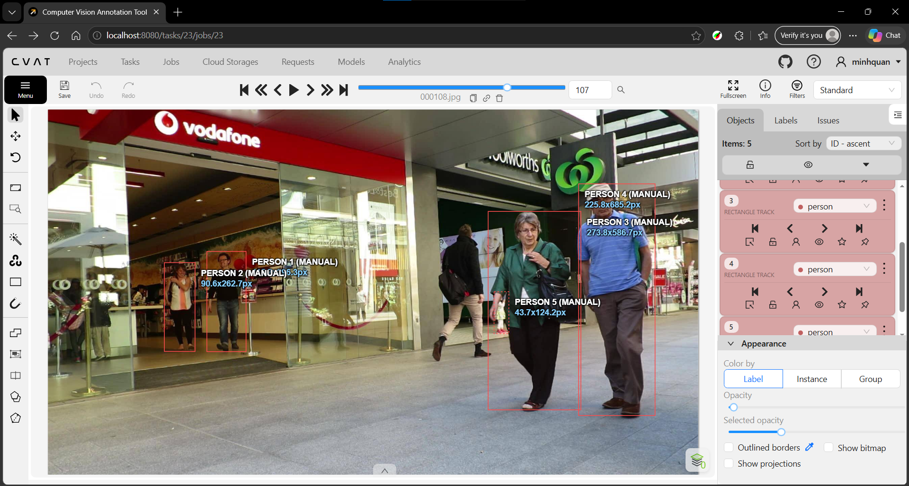
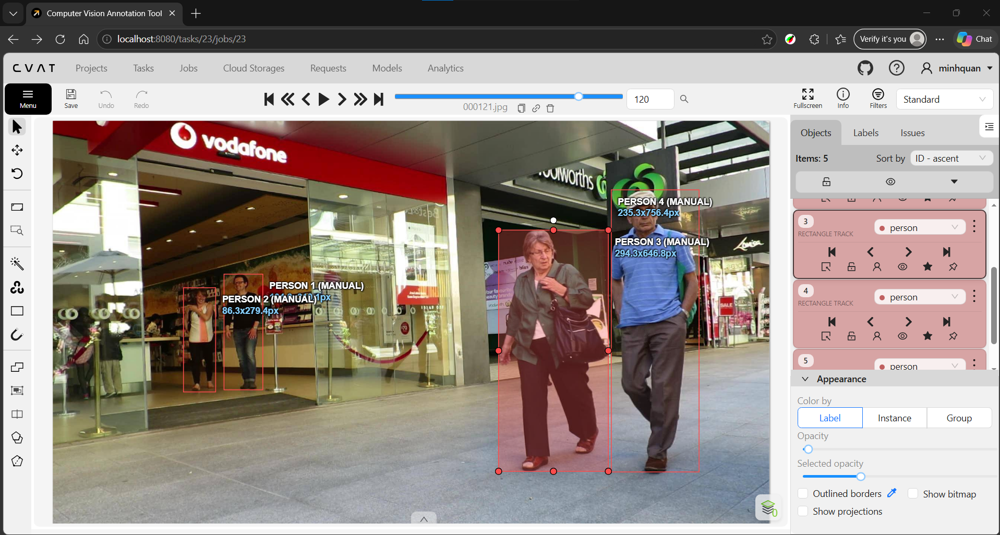
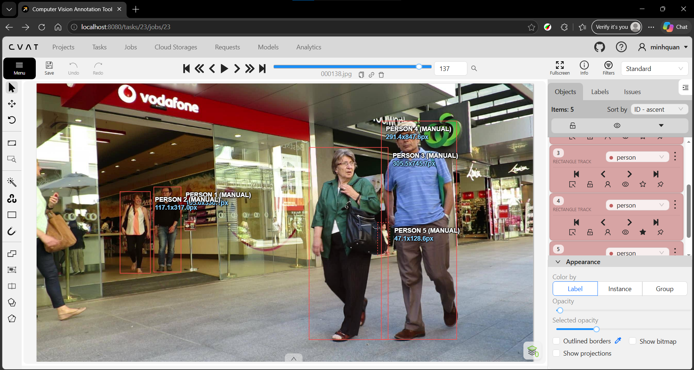
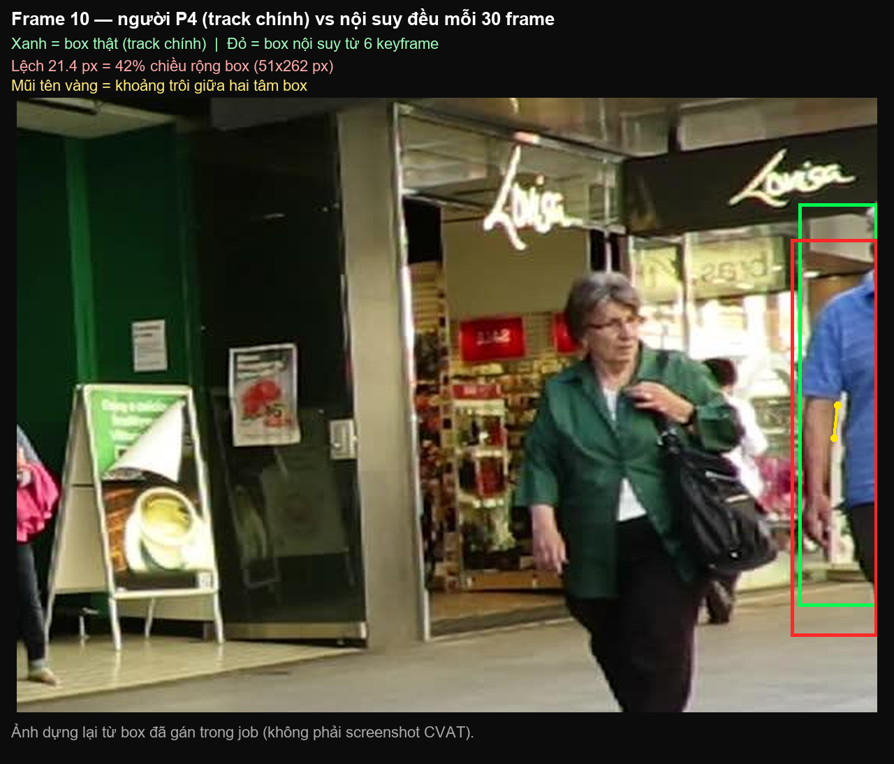

# Báo cáo cá nhân — DangMinhQuan-2A202603171

Đoạn video: MOT17-09, 150 frame (frame 1–150), nguồn MOTChallenge, giấy phép CC BY-NC-SA 3.0.

## 0. Thông tin học viên

- Họ tên: Đặng Minh Quân
- MSSV: 2A202603171
- Mã đề (A/B/C): **A**
- Email: minhquandl13@gmail.com
- Link repository: https://github.com/minhquandl13/K5-L2-DAY05-DangMinhQuan-2A202603171-MOTTracking
- Giờ bắt đầu: …
- Giờ kết thúc: …

Đề A theo `src/lab_variants.json` gồm 5 MOT ID: **1, 7, 19, 20, 21** (P1–P5). Tên task trên CVAT: `DAY05-MOT17-09-A-2A202603171`.

## 1. Xem trước đoạn video (CP0)

Số frame ghi theo CVAT (bắt đầu từ 0).

| Mã  | Frame xuất hiện | Frame cuối thấy được | Rẽ / dừng / đổi tốc độ ở frame                                                                   | Bị che ở frame                                          | Ghi chú                                                                            |
| --- | --------------- | -------------------- | ------------------------------------------------------------------------------------------------ | ------------------------------------------------------- | ---------------------------------------------------------------------------------- |
| P1  | 0               | 149                  | rẽ 144; đổi tốc 19, 54, 61, 71, 83, 85; chậm (<3 px/frame) 1–7, 9–10, 19–39, 54–60, 71–81, 83–84 | che một phần 30–39 và 50–53; mất hẳn 40–49              | Người đi chậm, hay dừng rồi đi tiếp; khó nhất ở đoạn 40–49                         |
| P2  | 54              | 149                  | rẽ 141, 146; đổi tốc 71, 146; chậm 55–60, 69–70, 81–103, 105–144, 146–149                        | không bị che                                            | Vào khung hình muộn (frame 54); đi chậm, box cao dần 218 → 339 px (lại gần camera) |
| P3  | 0               | 149                  | rẽ 11, 31, 41, 71; đổi tốc 11, 61, 75, 93, 97; chậm 1–10, 21–50, 61–74, 93–96                    | không bị che                                            | Đi nhanh nhất (trung bình 4,9 px/frame), nhiều lần đổi hướng                       |
| P4  | 0               | 149                  | rẽ 21, 23, 71, 81, 91; đổi tốc 11, 18, 21, 31, 61, 91; chậm 1–10, 18–19, 21–26, 31–60, 71–90     | không bị che                                            | Đi ở mép phải khung hình, box đổi kích thước mạnh khi lại gần camera               |
| P5  | 0               | 148                  | không rẽ, không đổi tốc; chậm 1–109, 137–148                                                     | che một phần 106–109, 136–139, 143–148; mất hẳn 110–135 | Người gần như đứng yên (0,5 px/frame) bị người khác đi qua che mất gần 1 giây      |

## 2. Keyframe và thời gian (CP1, CP4)

Số keyframe lấy từ kết quả `src/check_submission.py`.

| Mã       | Số keyframe | Keyframe ở frame                                                                                                                                          | Số frame có mặt | Keyframe / 100 frame | Thời gian (phút) | Chỗ khó                                                                                        |
| -------- | ----------- | --------------------------------------------------------------------------------------------------------------------------------------------------------- | --------------- | -------------------- | ---------------- | ---------------------------------------------------------------------------------------------- |
| P1       | 57          | 0, 6–8, 10, 17–23, 30, 50, 53–54, 60, 63, 70, 73–76, 79–84, 87–90, 100, 103–104, 108, 110–112, 120, 124, 126, 128, 130, 137–143, 145–149                  | 140             | 40,7                 | …                | Đoạn dừng 71–81 và chỗ mất hẳn 40–49                                                           |
| P2       | 23          | 54, 60, 66–68, 70, 80, 90, 100, 103–105, 110, 120, 130–133, 136, 140, 144–145, 149                                                                        | 96              | 24,0                 | …                | Vào khung muộn ở frame 54; đi chậm nên dễ trôi box nếu đặt keyframe thưa                       |
| P3       | 49          | 0, 10, 12, 14, 17, 20, 22–23, 27, 30, 40, 43, 47, 50, 54, 60, 67, 70–77, 79–80, 82, 86, 90–92, 94–96, 100, 110, 120, 128, 130–134, 138, 140, 142–143, 149 | 150             | 32,7                 | …                | Nhiều lần đổi hướng ở 11, 31, 41, 71 và tăng tốc đột ngột ở 97                                 |
| P4       | 39          | 0, 10, 15–26, 30, 40–45, 50, 52, 54, 60, 70, 80, 90, 100, 110, 113–114, 117, 120, 128, 130, 137, 140, 149                                                 | 150             | 26,0                 | …                | Đi từ mép phải vào gần camera nên box lớn dần (cao 163 → 947 px); tăng tốc đột ngột ở 11 và 91 |
| P5       | 34          | 0, 2–12, 14, 16, 18, 20, 23–24, 30, 40, 48–57, 106, 136, 140, 143                                                                                         | 123             | 27,6                 | …                | Hai đầu đoạn bị che: 106–109 và 136–148                                                        |
| **Tổng** | **202**     |                                                                                                                                                           | **659**         | **30,7**             | …                |                                                                                                |

Keyframe / 100 frame của cả bài = 202 ÷ 659 × 100 = **30,7**.

Bạn đặt keyframe nhiều nhất ở người nào? Vì sao?

P1 (57 keyframe, 40,7 keyframe / 100 frame — cao nhất bài). Lý do: P1 đi chậm và dừng hai lần (19–39 và 71–81), nên nội suy tuyến tính giữa hai keyframe xa nhau bị trôi; ngoài ra P1 còn phải đặt keyframe ở hai đầu đoạn mất hẳn 40–49 và hai đầu đoạn che một phần 30–39, 50–53 để tắt/mở cờ `occluded` và `outside` đúng frame. Mật độ đó vẫn dưới ngưỡng 50 keyframe / 100 frame nên không bị cảnh báo.

## 3. Đoạn bị che (CP2)

Người bị che: `P5` (track hiện số **5** trên giao diện CVAT, `id` 4 trong `annotations.xml`, `track_id` 4 trong `gt.txt`)

| Mốc                                      | Frame |
| ---------------------------------------- | ----: |
| Bắt đầu bị che một phần (bật `occluded`) |   106 |
| Mất hẳn (bật `outside`)                  |   110 |
| Hiện lại (tắt `outside`)                 |   136 |
| Thấy rõ trở lại (tắt `occluded`)         |   140 |

- Thời gian khuất hẳn: **26** frame = **0,87** giây.
- Quyết định: **giữ cùng ID** (vẫn là một track duy nhất mang ID của P5 từ frame 0 đến 148, không tạo track mới sau khi hiện lại).
- Lý do (trả lời 3 câu: khuất bao lâu so với 60 frame, ngoại hình có khớp, chỗ hiện lại có đúng hướng và tốc độ):

Khuất 26 frame, ngắn hơn nhiều so với ngưỡng 2 giây (60 frame) của lớp, nên theo quy ước không cần tạo track mới. P5 gần như đứng yên (tốc độ trung bình 0,5 px/frame, không có lần rẽ nào), nên khi hiện lại ở frame 136 vị trí, kích thước box và hướng vẫn trùng với trước khi bị che. Ngoại hình khớp với frame 105 (trước khi che) nên không có lý do đổi ID.

Ảnh chụp màn hình (cắt vùng cần thiết, ghi nguồn "MOT17, MOTChallenge (Milan et al., 2016)"):





## 4. Tự review ID (CP3)

Đã kiểm hai lượt: lượt 1 đi ngược từ frame 149 về 0 theo từng người, lượt 2 nhảy 10 frame theo cảnh. Hai lượt không phát hiện lỗi nào, nên ghi một dòng theo quy ước "đã kiểm hai lượt, không lỗi".

Ba chỗ tôi xem kỹ nhất, vì đó là chỗ dễ sinh lỗi ID:

- P1 quanh frame 30–54: bị che một phần (30–39), mất hẳn (40–49), hiện lại còn che một phần (50–53), rõ lại từ 54. Hai biên của cờ phải khớp đúng frame, và box ở frame 50 phải là cùng người với frame 29.
- P5 quanh frame 106–148: khuất hẳn 26 frame; kiểm tra frame 136 không bị tách thành track mới.
- P2 ở frame 54: frame đầu tiên của track, dễ đặt box muộn hoặc lệch.

Loại lỗi dùng đúng một trong 7 mã: `id_switch`, `fragmentation`, `lost`, `merge`, `false_track`, `drift`, `flag`.

| Frame | Mã người   | Loại lỗi     | Mô tả một câu                                                                                | Phát hiện ở lượt | Đã sửa? |
| ----: | ---------- | ------------ | -------------------------------------------------------------------------------------------- | ---------------- | ------- |
|     — | cả 5 người | không có lỗi | Đã kiểm hai lượt (149→0 theo người, và nhảy 10 frame theo cảnh), không phát hiện lỗi ID nào. | cả hai lượt      | —       |

Tổng hợp số lỗi theo loại:

| `id_switch` | `fragmentation` | `lost` | `merge` | `false_track` | `drift` | `flag` |
| ----------: | --------------: | -----: | ------: | ------------: | ------: | -----: |
|           0 |               0 |      0 |       0 |             0 |       0 |      0 |

Lỗi nào chỉ lượt 2 (theo cảnh) mới thấy, lượt 1 (theo người) không thấy? Vì sao?

Không có lỗi nào nên không có trường hợp này. Nhưng nếu phải nói vì sao lượt 2 hữu ích hơn ở một số chỗ: lượt 2 nhìn cả cảnh nên thấy được hai người đi sát nhau cùng lúc, đúng loại chỗ dễ bị `id_switch`; còn lượt 1 chỉ bám một người nên khi người đó bị che, tôi không thấy người đi qua che anh ta là ai.

## 5. File xuất và kết quả tự kiểm (CP4)

| Kiểm tra                                                  | Kết quả                                                                                                             |
| --------------------------------------------------------- | ------------------------------------------------------------------------------------------------------------------- |
| Tên file MOT 1.1                                          | `src/exports/DangMinhQuan_mot.zip`                                                                                  |
| Tên file CVAT for video 1.1                               | `src/exports/DangMinhQuan_cvat_video.zip`                                                                           |
| Số track ID khác nhau trong `gt/gt.txt` (phải là 5)       | **5** (tổng 659 box)                                                                                                |
| Frame `outside` không có dòng trong `gt.txt` (đúng / sai) | **Đúng** — kiểm chứng: P1 vắng ở frame 40–49, P5 vắng ở frame 110–135, `gt.txt` không có dòng nào cho hai khoảng đó |
| Job đã completed trên CVAT máy cá nhân                    | …                                                                                                                   |

Dán phần tóm tắt in ra từ `src/check_submission.py`:

```text
=== File MOT 1.1: DangMinhQuan_mot.zip ===
  Số track ID: 5   |   Tổng số box: 659
  [OK]        Đúng 5 track ID.

  Track | Frame có mặt | Số frame | Đoạn vắng (outside)
      1 |   0–149      |      140 | 40–49
      2 |   0–149      |      150 | -
      3 |   0–149      |      150 | -
      4 |   0–148      |      123 | 110–135
      5 |  54–149      |       96 | -

=== File CVAT for video 1.1: DangMinhQuan_cvat_video.zip ===

  Track | Nhãn   | Frame thấy | Keyframe | KF/100 frame | Frame occluded | Lần bật outside
      0 | person |        140 |       57 |         40.7 |             14 |               1
      1 | person |         96 |       23 |         24.0 |              0 |               0
      2 | person |        150 |       49 |         32.7 |              0 |               0
      3 | person |        150 |       39 |         26.0 |              0 |               0
      4 | person |        123 |       34 |         27.6 |             14 |               2

  Tổng: 202 keyframe / 659 frame có mặt = 30.7 keyframe / 100 frame
  [OK]        Đọc được 5 track từ annotations.xml.

=== Tóm tắt ===
  Lỗi: 0   |   Cảnh báo: 0
  Đạt. Dán phần tóm tắt này vào báo cáo mục 5.
```

Lưu ý về số track (ba cách đánh số khác nhau, dễ nhầm):

- Trên **giao diện CVAT**: 5 track hiện số **1–5** đúng theo thứ tự P1–P5. Người bị che ở mục 3 là **track số 5** trên giao diện (P5).
- Trong **`annotations.xml`**: cùng 5 track đó mang `id` **0–4** (nhỏ hơn số hiển thị 1 đơn vị).
- Trong **`gt.txt`**: cột `track_id` là số **1–5** do CVAT đánh lại khi xuất MOT, **không** theo thứ tự P và **không** phải MOT ID gốc (1, 7, 19, 20, 21).

Ánh xạ đã kiểm chứng bằng IoU giữa box trong `gt.txt` và box keyframe trong `annotations.xml` (IoU = 1,000 ở cả 5 track), và bằng vị trí box ở frame tham chiếu của từng P trong bảng nhận diện:

| P   | MOT ID gốc | `track_id` trong `gt.txt` | Số trên giao diện CVAT | `id` trong `annotations.xml` |
| --- | ---------: | ------------------------: | ---------------------: | ---------------------------: |
| P1  |          1 |                         1 |                      1 |                            0 |
| P2  |          7 |                         5 |                      2 |                            1 |
| P3  |         19 |                         2 |                      3 |                            2 |
| P4  |         20 |                         3 |                      4 |                            3 |
| P5  |         21 |                         4 |                      5 |                            4 |

## 6. Ba câu kết

1. Nếu được gán lại, bạn sẽ đặt keyframe khác ở đâu? Vì sao?

   Tôi sẽ bớt keyframe ở cuối P1 (frame 137–149) và giữ dày ở chỗ P4 đổi tốc. Lý do: đoạn 137–149 của P1 người đi đều, tôi đặt tới 12 keyframe (137–143 và 145–149) mà box vẫn không trôi, đặt dày như vậy chỉ tốn thời gian. Ngược lại ở P4, đoạn 11–26 vận tốc đổi liên tục (tăng mạnh ở frame 11 rồi giảm ở frame 18), nên keyframe dày ở đó là cần thiết để box bám sát người. Nói cách khác, tôi đặt keyframe theo cảm giác "chỗ khó" chứ chưa đo trước, nên có chỗ dày quá, có chỗ vẫn có thể thưa hơn.

2. Có chỗ nào bạn không chắc "cùng ID hay ID mới"? Bạn đã quyết định và ghi chú thế nào?

   Chỗ tôi lưỡng lự nhất là P5 ở frame 110–135, khi anh ta bị người khác đi qua che mất hẳn. Tôi chọn giữ cùng ID và không tạo track mới, vì thời gian khuất là 26 frame, ngắn hơn ngưỡng 60 frame (2 giây) của lớp. Thêm một lý do nữa: người này gần như đứng yên (tốc độ trung bình 0,5 px/frame), nên khi hiện lại ở frame 136 box vẫn ở đúng chỗ cũ (khoảng x 1338–1342), không bị lệch sang người khác. Tôi ghi chú quyết định này ở mục 3. Chỗ thứ hai là P1, khuất 10 frame ở 40–49, cũng giữ cùng ID vì quá ngắn.

3. Một lỗi ID trong job của bạn (nếu không còn sót, chọn lỗi đã sửa) có thể làm xe tự lái dự đoán sai chuyển động của người đó như thế nào? Lỗi đó ảnh hưởng MOTA hay IDF1 nhiều hơn?

   Job của tôi không còn lỗi ID nào, nên tôi lấy tình huống sát nhất là chỗ P5 bị che rồi hiện lại: nếu lúc đó tôi tạo track mới thay vì giữ ID (tức lỗi `fragmentation`), thì tracker phía sau sẽ coi đây là một người mới xuất hiện. Xe sẽ mất quán tính và hướng đi cũ của người đó, phải khởi động lại dự đoán chuyển động từ con số 0, nên trong vài frame có thể đoán sai người đó đang đi sang đâu — hệ thống phanh có thể phanh chậm hoặc phanh thừa. Với điểm số: lỗi này ảnh hưởng IDF1 nhiều hơn, vì IDF1 ghép cả track với cả track và phạt việc một người thật bị tách thành hai ID; còn MOTA chủ yếu đo detection nên một lần IDSW chỉ làm giảm rất ít, ví dụ với GT = 659 thì mỗi IDSW chỉ khoảng 0,15% điểm.

## Bonus (nếu làm)

### B1 — Hai người đi sát

…

### B2 — So cách đặt keyframe

Người được chọn để so: **P4** (track số 4 trên giao diện CVAT, người áo xanh). Lý do chọn P4: track này có mặt đủ 150 frame và không bị che ở frame nào, nên phép so không bị nhiễu bởi cờ `occluded` / `outside`; và P4 đúng là người tăng tốc đột ngột ở frame 11, tức chỗ mà cách đặt keyframe đều sai nhiều nhất.

Cách so: lấy đúng box đã gán của track chính tại 6 keyframe **0, 30, 60, 90, 120, 149**, nội suy tuyến tính từng thành phần `x, y, w, h` cho các frame ở giữa — đây chính là phép nội suy mà CVAT dùng khi track chỉ có keyframe ở 6 frame đó. Độ trôi = khoảng cách giữa tâm box nội suy và tâm box của track chính (track chính là box tôi gán tay, dày hơn).

| Cách đặt                                   | Số keyframe |                Frame trôi nhất | Ghi chú                                                                                                                                                                                                                                                                  |
| ------------------------------------------ | ----------: | -----------------------------: | ------------------------------------------------------------------------------------------------------------------------------------------------------------------------------------------------------------------------------------------------------------------------ |
| Đều mỗi 30 frame (0, 30, 60, 90, 120, 149) |       **6** |                         **10** | Lệch **21,4 px**, gần như toàn bộ theo trục dọc (`dy` = +21,2 px), bằng **42% chiều rộng box** (box chỉ 51 × 262 px nên con số này rất dễ thấy). Có **43 / 150 frame lệch quá 10 px**. Frame 140 lệch 19,9 px nhưng box đã lớn (288 × 863 px) nên chỉ còn 7% chiều rộng. |
| Theo chỗ đổi hướng (track chính)           |      **39** | không frame nào lệch quá 10 px | Keyframe cách nhau tối đa **10 frame**, trung bình **3,9 frame**. Đặt dày đúng chỗ P4 tăng tốc (frame 11) và giảm tốc (frame 18), nên box bám người suốt đoạn.                                                                                                           |

Giải thích bằng giả định vận tốc không đổi: nội suy tuyến tính giữa hai keyframe coi như người đi với vận tốc không đổi trong cả khoảng đó. P4 gần như đứng yên ở frame 0–10 (0,9 px/frame) rồi vọt lên 7,4 px/frame từ frame 11. Cặp keyframe 0–30 lấy tổng dịch chuyển của 30 frame chia đều thành một vận tốc trung bình, nên tại frame 10 box đã "đi trước" người thật khoảng 21 px theo trục dọc — tức nửa chiều rộng box. Track chính không mắc lỗi này vì có keyframe đúng ở frame 11 và 18, đúng hai chỗ vận tốc thật sự đổi.

Frame trôi nhất (frame 10) — xanh là box track chính, đỏ là box nội suy 6 keyframe:



Ảnh trên dựng lại từ box đã gán trong job và khung hình gốc `000011.jpg`, không phải ảnh chụp màn hình CVAT.

### B3 — So với tracker có sẵn

| Frame | Mã người | Tracker làm gì | Nhãn của bạn | Giải thích (đoán rồi sửa / ghép IoU / box score thấp / ngoại hình) |
| ----: | -------- | -------------- | ------------ | ------------------------------------------------------------------ |
|       |          |                |              |                                                                    |
|       |          |                |              |                                                                    |

## 7. Tài liệu tham khảo và công cụ AI đã dùng

Tài liệu:

- MOT17 / MOTChallenge — Milan et al., 2016. Giấy phép CC BY-NC-SA 3.0. Ảnh minh chứng: "MOT17, MOTChallenge (Milan et al., 2016)".
- CVAT docs — định dạng MOT: https://docs.cvat.ai/docs/dataset_management/formats/format-mot/
- `docs/MOT_FORMAT.md`, `docs/GUIDELINE.md`, `docs/CVAT_CHEATSHEET.md` của repo lab.
- py-motmetrics / TrackEval (công cụ chấm của coach).

Công cụ AI đã dùng:

- Trợ lý AI dạng chat: giải thích khái niệm MOTA, IDF1, `occluded` / `outside`, định dạng MOT 1.1; chẩn đoán lỗi khi chạy `src/setup_local_lab.py` và `src/check_submission.py`; sửa câu chữ trong báo cáo; thống kê số frame / keyframe / đoạn vắng từ hai file xuất (mục 1, 2, 3, 5); viết bản nháp mục 4 và mục 6 từ số liệu thật của job, sau đó tôi đọc lại và chỉnh theo những gì tôi thực sự thấy khi review.
- Bonus B2: trợ lý AI xử lý file `gt.txt` để đo độ trôi của cách đặt keyframe đều mỗi 30 frame và dựng ảnh minh hoạ frame 10 từ box đã gán; số keyframe hai cách và kết luận vận tốc không đổi là phần tôi tự kiểm lại.
- Không dùng AI để sinh box hay track ID; toàn bộ nhãn trong `src/exports/` do tôi gán tay trên CVAT.
